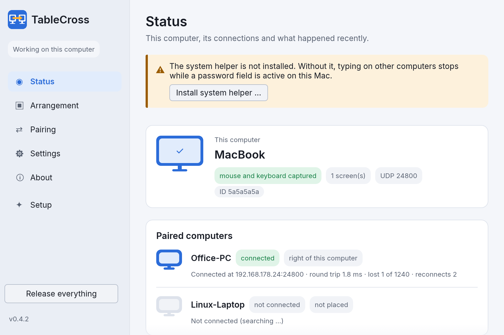
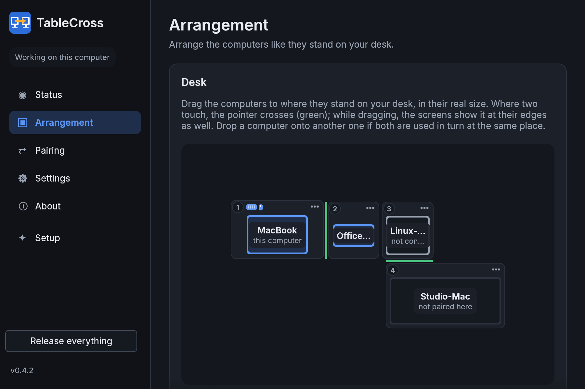
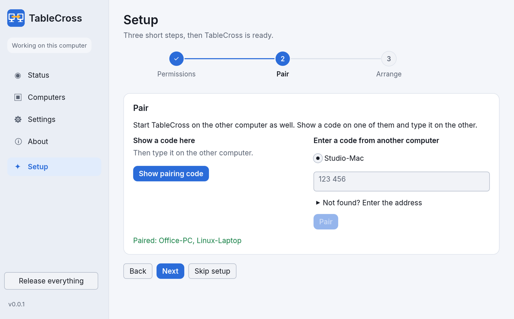

# TableCross

Share one mouse, keyboard and clipboard between computers on your desk: macOS, Windows and Linux
(Wayland on GNOME and KDE Plasma, and X11). Move the pointer over the edge of one screen and keep working
on the next computer.







*The screenshots show made-up computers (`TC_DEMO=1`).*

> **Status: first release.** Downloads are on the
> [releases page](https://github.com/eckonator/tablecross/releases). So far it is tested most on macOS;
> Windows and Linux may still have rough edges. The *test build* there is the newest state of
> development, replaced with every change.

## Installing

**macOS 11 or newer** (Apple silicon and Intel):

1. Download `TableCross-…-macOS.dmg` from the
   [releases page](https://github.com/eckonator/tablecross/releases), open it and drag TableCross into
   Applications.
2. Open TableCross. TableCross does not come through Apple's paid developer program, so macOS refuses
   it the first time (“Apple could not verify …”). Click **Done**.
3. Open **System Settings → Privacy & Security**, scroll down and click **Open Anyway** next to
   TableCross, then confirm with your password. On macOS 11 to 14, a right-click on TableCross →
   **Open** does the same.
4. TableCross guides you through the rest: the **Accessibility** permission (needed to use mouse and
   keyboard), possibly access to the local network, and the optional helper for password fields.

This is needed only once. Later versions install from inside the app (**Update now** on the status
page) and keep all permissions.

If TableCross still asks for a permission that is already switched on (possible after updating from an
older version), select TableCross in that list, remove it with **–** and add it again with **+**;
switching it off and on is not enough.

Using Terminal instead: this installs the newest version without the Gatekeeper step

```sh
curl -fsSL https://raw.githubusercontent.com/eckonator/tablecross/main/scripts/install-macos.sh | bash
```

and this lets a copy from the `.dmg` or `.zip` start right away:

```sh
xattr -dr com.apple.quarantine /Applications/TableCross.app
```

**Windows 10 and 11** (64-bit): run `TableCross-…-Windows-Setup.exe`. It installs the app, the optional
service for the sign-in screen and elevated programs, and opens UDP port 24800 for private networks.
Windows may warn about an unknown publisher (“Windows protected your PC”): click **More info → Run
anyway**. Later versions install from inside the app (**Update now**). There is also a portable `.zip`.

**Linux** (X11, or Wayland on GNOME 45+ / KDE Plasma 6.1+), x86_64 or arm64: unpack the `.tar.gz` and
run `./install.sh` (installs for the current user; `./install.sh --uninstall` removes it). GNOME shows
the TableCross symbol and its menu only with the AppIndicator extension (Debian/Ubuntu:
`sudo apt install gnome-shell-extension-appindicator`, then log out and in and switch it on in
**Extensions**).

**Raspberry Pi 4/5** (64-bit Raspberry Pi OS): use the `arm64` archive. The default desktop (labwc or
Wayfire on Wayland) offers no way for programs to read or send input, so switch to X11 in
`sudo raspi-config` → Advanced Options → Wayland → X11.

### Antivirus warnings

TableCross reads the keyboard and mouse to send them to the other computer. Programs that do this
look like keyloggers to some antivirus software, so a warning is possible, especially on Windows.
TableCross only sends input to computers you paired yourself, encrypted, on your local network; the
source code is open for anyone to check.

## The app

`tablecross` opens a window with three setup steps (permissions, pairing with a code, arranging the
computers by dragging) and a status page per computer (connection, round trip, problems with a way
out, recent messages, “copy diagnostics”). Closing the window keeps TableCross running in the menu
bar (macOS) or notification area (Windows). The interface is in English and German.

Any number of computers can share one desk. The arrangement is shared between all paired computers,
and the Arrangement page shows the whole desk: drag each computer to where it stands, drawn in the
real size of its screens. Computers may stand offset, half beside or below another one, and one side
may have several neighbors; the pointer crosses only where the edges touch, at the matching place
(shown green, and while dragging also as green bars at the real screen edges of every computer). A
computer keeps its size when screens are switched off or on; *Take over the current size* in its
menu adopts the screens it has now. New computers are paired on the Pairing page.

Settings worth knowing: all edges switch at once; for top and bottom, *after a moment of pushing* or
*after touching twice* protects the Dock and the menu bar instead, and the corners where left and
right edges do not switch can be widened or switched off. Ctrl+Shift+Alt+F (or the status icon menu)
keeps the pointer on the computer it is on until pressed again. *Keep this computer from going to sleep* (with the screen on as well, if
wanted) for a computer in the middle of the desk, so the way over it to the others stays open. On
macOS, TableCross switches off Universal Control at start, which also takes the pointer at screen
edges; the status page warns while it is on.

Removing it: Settings → *Remove TableCross* takes away everything TableCross set up (system helper,
permissions, starting with the system, the program; optionally settings and pairings).

## Goals

- **Reliable first.** Automatic reconnect after sleep, network changes and restarts; no stuck keys
  (all keys are released when the pointer leaves or a connection drops); a status page that says
  plainly what is wrong (missing permission, no connection, latency).
- **Works while password fields are active on macOS.** A small system helper reads the keyboard below
  the window server, so typing on the other computer keeps working when an app holds Secure Input.
- **Layout-independent keys.** Keys travel as USB HID codes, not characters, so German, US and other layouts
  behave like a real keyboard plugged into the other computer.
- **Simple setup.** Computers find each other on the local network and pair with a short code.
  Traffic is always encrypted.
- **Clipboard and files.** Text, rich text and images. Files copied on one computer are pasted with
  ⌘V in the Finder of a Mac, wherever you want them, and travel only then; on Windows and Linux
  they are saved through the menu of the TableCross symbol. Files dragged from a Mac over the edge
  keep being dragged on another Mac and land where you drop them; elsewhere they land in
  `Downloads`, which opens.
- **Windows sign-in screen.** An optional Windows service keeps control on the login and UAC screens.

Local network only, no cloud, no account, no telemetry. If you allow it, the app asks GitHub now and
then whether a newer version exists.

On Linux, X11 sessions work directly. Wayland sessions use the desktop portals (GNOME 45 or newer,
KDE Plasma 6.1 or newer): the system asks once for permission to control this computer, and again
when TableCross starts capturing. While a Wayland computer is controlled from elsewhere, its own
mouse cannot take control back (the system does not tell programs about input); use the keyboard
shortcut on the controlling computer instead.

## Building

Requires Rust 1.99 or newer.

```sh
cargo test --workspace
cargo clippy --workspace --all-targets -- -D warnings
```

## Command line tool

`tablecross-cli` connects computers without the app, for development and testing:

```sh
tablecross-cli pair            # on the first computer: shows a 6-digit code
tablecross-cli pair 123456     # on the second computer: finds the first one and pairs
tablecross-cli ping            # on both: keeps the connection, prints round trip, losses and reconnects
tablecross-cli peers           # paired computers and the ones found on the network
```

Sharing mouse and keyboard (both computers paired):

```sh
tablecross-cli place office-pc right   # on the Mac: the PC stands right of it
tablecross-cli run                     # on both
```

The arrangement is shared between all paired computers, so placing a computer once is enough. With
three or more computers, pair each one with every other one; then every keyboard reaches every
screen, for example from the Linux computer through the Mac on to the Windows PC. Computers used in
turn at the same place (two laptops on the same monitors, say) share a tile in the arrangement; the
edge leads to the one that is connected.

Move the pointer over the edge to control the other computer; moving a computer's own mouse takes
control back. All edges switch at once (optionally top and bottom only after pushing or touching
twice, see the settings). Its own keyboard simply keeps typing there, so the mouse of one computer and the
keyboard of another work together. Ctrl+Shift+Alt+Esc releases everything at once. `--swap-cmd-ctrl` on
`place` swaps ⌘ and Ctrl while controlling that computer. On macOS the terminal (later the app) needs
the Accessibility permission.

On macOS, typing on the other computer stops working while a program holds Secure Input (password
fields, some terminals and password managers). The system helper reads the keyboard below that
barrier and takes it away from the Mac only while the pointer is on the other computer:

```sh
tablecross-cli helper install   # asks for the administrator password
tablecross-cli helper status    # then allow it under Privacy & Security → Input Monitoring
tablecross-cli helper update    # after an update of TableCross (the app does this by itself)
```

If TableCross stops or crashes, the helper gives the keyboard back within a second.

On Windows, the optional service lets TableCross operate the sign-in screen, UAC prompts and programs
started as administrator (run once in an administrator prompt):

```sh
tablecross-service install
```

Without network discovery (`--no-discovery`) pass the address of the other computer with `--addr IP:PORT`.
Traffic uses UDP port 24800; allow it in the firewall for private networks.

## License

GPL-3.0-or-later, see [LICENSE](LICENSE).
